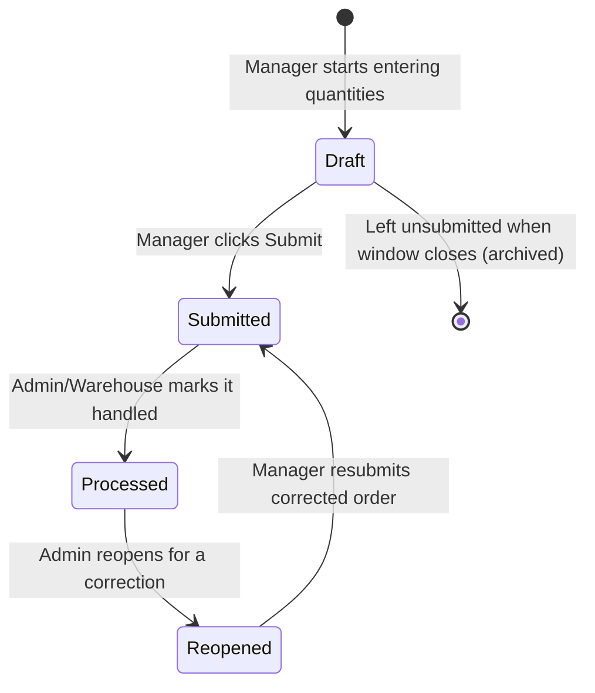
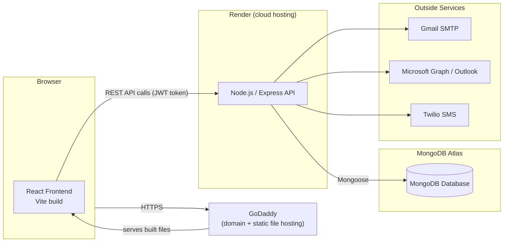
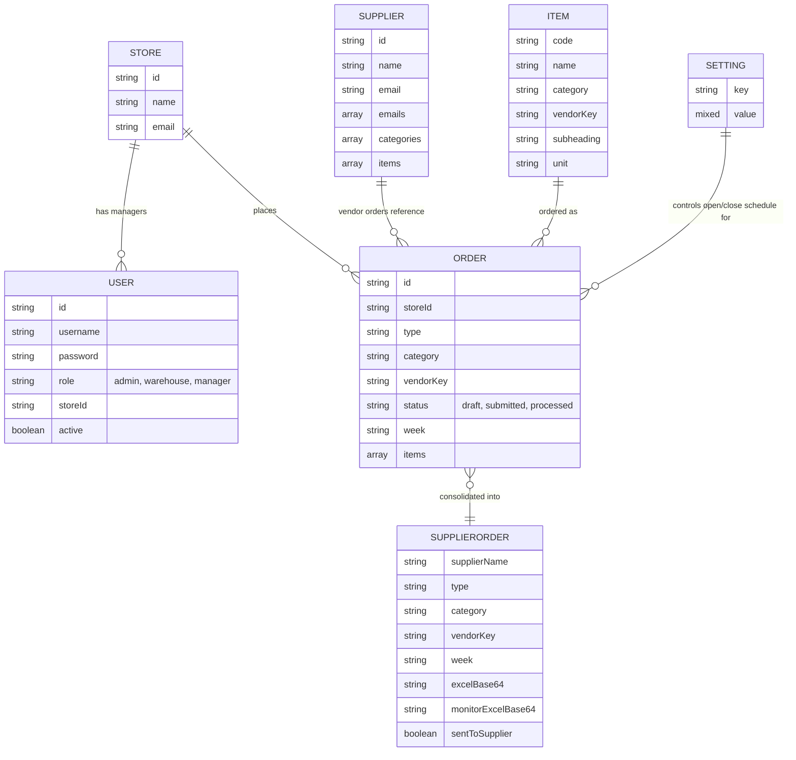

# 📖 Apna Bazar Ordering App — Complete Project Overview & Scope

This document explains **what this project is, who it's for, everything it can do, and how it's built** — from a business point of view first, then a technical deep-dive. Read top to bottom for the full picture, or jump to a section using the links below.

**Contents**
1. [What This App Is](#1-what-this-app-is)
2. [Project Scope](#2-project-scope)
3. [Who Uses It — Roles & Permissions](#3-who-uses-it--roles--permissions)
4. [Order Categories Explained](#4-order-categories-explained)
5. [Feature Walkthrough (Screen by Screen)](#5-feature-walkthrough-screen-by-screen)
6. [How an Order's Life Cycle Works](#6-how-an-orders-life-cycle-works)
7. [Automation — Things That Happen Without Anyone Clicking](#7-automation--things-that-happen-without-anyone-clicking)
8. [Notifications & Communication](#8-notifications--communication)
9. [Documents Generated by the App](#9-documents-generated-by-the-app)
10. [Technical Architecture](#10-technical-architecture)
11. [Data Model (What Information Is Stored)](#11-data-model-what-information-is-stored)
12. [API Overview](#12-api-overview)
13. [Where Everything Lives Online](#13-where-everything-lives-online)
14. [Security Notes & Known Limitations](#14-security-notes--known-limitations)
15. [Related Documents](#15-related-documents)

---

## 1. What This App Is

The **Apna Bazar Ordering App** ("OrderManager") is an internal ordering system for **Apna Bazar Stores**. It replaces phone calls, texts, and spreadsheets between store managers, the head office/warehouse, and outside suppliers/vendors with a single website.

In plain terms, it lets:
- **Store managers** place weekly orders for vegetables, leafy greens, vendor products, and warehouse stock — from any device with a browser
- **Warehouse/Admin staff** see every store's order in one place, combine ("consolidate") them into a single purchase order, and email that combined order straight to the supplier
- **Suppliers** receive a clean, ready-to-use Excel or Word order document by email — no manual copy-pasting required
- **Everyone** get automatic email/SMS reminders so orders don't get missed, and a full history of what was ordered and when

Live production site: **[https://apnabazarstoresordering.com/](https://apnabazarstoresordering.com/)**

---

## 2. Project Scope

### ✅ In Scope (what the app does today)
- Multi-store, multi-role ordering portal (managers, warehouse staff, admins)
- Four independent order categories: **Vegetables**, **Leaves**, **Vendor Orders**, **Warehouse Inventory**
- Weekly/scheduled ordering cycles with open/close windows configured by admins
- Draft saving, submission, locking, and admin "processing" of orders
- Consolidated (combined, all-store) order views with inline editing before sending to a supplier
- Supplier and vendor directory management (contacts, emails, assigned items)
- Store and user (staff account) management with enable/disable controls
- Item Master catalog: manual entry, bulk CSV/Excel upload, and DOCX/Excel **template** uploads that control how supplier documents look
- Automatic generation and emailing of Excel/Word order documents to suppliers
- Order history and "reopen" workflow to correct/resend an order after it was already sent
- In-app notifications, plus outbound **email** (Gmail or Outlook/Microsoft 365) and **SMS** (Twilio) reminders for pending orders
- Scheduled automatic opening/closing of vendor & warehouse ordering windows (no manual admin action required every week)
- Responsive web UI usable on phone, tablet, or desktop

### 🚫 Out of Scope (not part of this project)
- Payments, invoicing, or accounting/bookkeeping
- Inventory tracking of *received* stock (this app tracks what was *ordered*, not warehouse stock levels beyond a simple inventory count field)
- Public customer-facing shopping (this is an **internal** staff tool, not a storefront for shoppers)
- Native mobile apps (it is a responsive website, not an iOS/Android app)
- Multi-tenant support for other businesses (built specifically for Apna Bazar Stores)

---

## 3. Who Uses It — Roles & Permissions

The app has **three account roles**. Every login (username/password) is tied to exactly one role.

| Role | Who this is | What they can do |
|---|---|---|
| **Admin** | Business owner / head office | Everything: manage users, stores, suppliers, items, settings, schedules, all order categories, view/edit/reopen any order, send test emails |
| **Warehouse** | Warehouse staff who run day-to-day vendor ordering | Everything related to running order cycles: Order Monitor, Consolidated, Supplier Orders, Item Master, Suppliers, and opening/closing **vendor order** windows. Cannot manage Users, Stores, or core system Settings — those stay admin-only |
| **Manager** | Store-level staff placing orders for their location | Dashboard, Place Order (for whichever categories are currently open for their store), and their own Order History. Cannot see other stores' data or any admin screens |

Each **Manager** account is linked to exactly one store, so they only ever see and place orders for that store.

---

## 4. Order Categories Explained

The app tracks four independent kinds of ordering, each with its own schedule, item catalog, and history:

| Category | Purpose | Example |
|---|---|---|
| **Vegetables** | Regular recurring vegetable orders from stores | Onions, potatoes, tomatoes |
| **Leaves** | Leafy greens, ordered on a separate schedule from vegetables | Spinach, cilantro, mint |
| **Vendor Orders** | Orders placed with specific outside **vendors/suppliers** (each vendor has its own item list, schedule, and document template) | A specific produce or grocery vendor |
| **Warehouse Inventory** | Orders that go through the internal warehouse instead of directly to a vendor | Bulk/shelf-stable items stocked at the warehouse |

Each category can be **open** (stores can currently submit orders) or **closed** (locked, no new submissions) on its own schedule, configured under **Settings**.

---

## 5. Feature Walkthrough (Screen by Screen)

### For Store Managers
| Screen | What it's for |
|---|---|
| **Dashboard** | Shows which order types are currently open, which still need to be submitted ("Action Required"), and quick links to place them |
| **Place Order** | Enter quantities for each item in an open category (choose unit type: case, pieces, pallet, master case, or custom), save as a draft, or submit |
| **Order History** | See everything this store has submitted in the past, by week and category |

### For Admin / Warehouse Staff
| Screen | What it's for |
|---|---|
| **Dashboard** | Overview across all stores: who has and hasn't submitted, quick shortcuts into Consolidated views for anything pending |
| **Order Monitor** | See every individual store's order for a given cycle, mark orders as "processed," and reopen a previously closed/sent order if a correction is needed |
| **Consolidated** | Combine every store's order for a category/vendor/week into one master list, edit quantities in one place, and send the finished order to the supplier by email |
| **Supplier Orders** | History of everything that's already been finalized and sent to suppliers, with the ability to re-download or re-view the exact document that was emailed |
| **Warehouse Inventory** | Same idea as Vendor Orders, but for items sourced through the internal warehouse |
| **Item Master** | Add/edit/delete catalog items, bulk-import via CSV/Excel, and upload a supplier's own order-form template (Excel or Word) so generated documents match what that supplier expects |
| **Suppliers** | Manage vendor/supplier contacts — name, one or more emails, phone, which item categories/items they supply |
| **Stores** (admin only) | Add/edit/remove store locations and their contact email |
| **Users** (admin only) | Create staff logins, assign roles and stores, enable/disable accounts, reset passwords |
| **Settings** (admin only, some vendor-schedule controls also available to warehouse) | Configure weekly open/close schedules per category, vendor-specific ordering windows, and the text of automated messages |

---

## 6. How an Order's Life Cycle Works

Every order moves through a simple set of **statuses**:

- **Draft** — a manager has started an order but not submitted it yet. Drafts autosave so nothing is lost if the browser closes.
- **Submitted** — the manager has finalized their order for that week; the form locks so it can't be accidentally changed.
- **Processed** — an admin/warehouse user has reviewed and actioned the order (e.g., included it in a consolidated send to the supplier).
- **Reopened** — if a mistake is found *after* an order was sent to a supplier, an admin can reopen that specific store/week/category so the manager can resubmit corrected numbers, then it goes through Consolidated again.

### "Weeks" and Cycles
Every order is tagged with a **week key** (the ordering cycle it belongs to) and, for vendor/warehouse orders, a **sequence number** that increases every time that vendor's ordering window is opened again. This is how the app tells apart "this week's order" from "last week's order" for the same store and category, even if the exact calendar days shift slightly.

---

## 7. Automation — Things That Happen Without Anyone Clicking

- **Vendor Cycle Manager** — a background service that automatically **opens and closes** vendor/warehouse ordering windows according to the schedule set in Settings, and automatically **archives** any store orders that were left unsubmitted when a window closes, so nothing is silently lost.
- **Reminder Scheduler** — a background service that periodically checks which stores still have a pending (not-yet-submitted) order for an open cycle, and automatically sends **SMS text reminders** (via Twilio) to those store managers before the deadline.

Both of these run continuously on the backend server — no one has to remember to open/close a cycle or send reminders manually, though admins can still do it manually if needed.

---

## 8. Notifications & Communication

| Channel | Used for | Powered by |
|---|---|---|
| **In-app notifications** | Announcements/alerts shown inside the app for all logged-in users | Stored directly in the database |
| **Email** | Sending consolidated supplier orders, order confirmations, and admin test emails | Either a **Gmail** account (app password) or an **Outlook/Microsoft 365** mailbox (via Azure app registration + Microsoft Graph) — whichever is configured on the server |
| **SMS** | Automatic reminders to store managers about pending orders | **Twilio** (a phone-number/SMS provider) — requires a Twilio account and phone number to be configured |

---

## 9. Documents Generated by the App

When a consolidated order is sent to a supplier, the app automatically builds a ready-to-use file and attaches it to the email:

- **Excel workbooks** — a clean spreadsheet with product names, quantities, and totals, with section headings preserved from the Item Master
- **Word (DOCX) documents** — used for suppliers who provide their own order-form template; the app fills in each item row (including per-store breakdowns) while keeping that supplier's exact layout, tabs, and formatting
- **Two versions of every vendor document** are kept: a simple **total-only** version sent to the supplier, and a **full breakdown** version (with a column per store) kept internally for the Order Monitor / Supplier Orders history

---

## 10. Technical Architecture

| Layer | Technology | Notes |
|---|---|---|
| **Frontend** | React 18 + Vite | Single-page app; built into static HTML/CSS/JS with `npm run build`; deployed to GoDaddy |
| **Backend** | Node.js + Express | REST API; deployed as a Web Service on Render |
| **Database** | MongoDB (via Mongoose), hosted on MongoDB Atlas | Cloud-hosted, no local database server needed in production |
| **Authentication** | JWT (JSON Web Tokens) | Issued at login, expires after 24 hours, sent as a Bearer token on every API request |
| **File generation** | `exceljs` (Excel) and a custom DOCX template engine | Runs entirely on the backend when a consolidated order is sent |
| **Email** | `nodemailer` (Gmail/SMTP) and Microsoft Graph API (Outlook) | Whichever is configured via environment variables |
| **SMS** | Twilio REST API | Used only by the reminder scheduler |

---

## 11. Data Model (What Information Is Stored)

| Entity | Purpose |
|---|---|
| **User** | Login accounts — username, password, role, linked store (for managers) |
| **Store** | A physical store location and its contact email |
| **Item** | A catalog product — code, name, category, optional vendor, unit type |
| **Supplier** | A vendor/supplier contact — name, email(s), phone, which items/categories they handle |
| **Order** | One store's order for one category/week — a list of item quantities and its status |
| **SupplierOrder** | A finalized, consolidated order that was (or will be) sent to a supplier, including the generated Excel/Word file |
| **Setting** | Key/value configuration — schedules, vendor order configs, message templates |
| **Notification** | An in-app announcement/alert |
| **SmsReminderLog** | A record of every automatic SMS reminder sent, to avoid duplicate texts |

---

## 12. API Overview

All endpoints are prefixed with `/api` and (except login) require a `Bearer` JWT token in the `Authorization` header.

| Group | Examples | Notes |
|---|---|---|
| **Auth** | `POST /auth/login`, `POST /auth/verify` | Issues/validates JWT tokens |
| **Items** | `GET/POST /items`, `POST /items/bulk/import` | Catalog management + CSV/template import |
| **Orders** | `GET/POST /orders`, `POST /orders/:id/process`, `GET /orders/consolidated/:type`, `POST /orders/consolidated/:type/email` | Placing, processing, and consolidating orders |
| **Users** | `GET/POST /users`, `PATCH /users/:id/toggle`, `POST /users/:id/reset-password` | Admin/warehouse account management |
| **Suppliers** | `GET/POST/PATCH/DELETE /suppliers`, `POST /suppliers/:id/items` | Vendor directory |
| **Stores** | `GET/POST/PATCH/DELETE /stores` | Store locations |
| **Notifications** | `GET/POST/DELETE /notifications` | In-app alerts |
| **Settings** | `GET /settings`, `PATCH /settings/schedule/:type`, `PATCH /settings/message/:type` | Schedules and vendor order configs |
| **Test Email** | `POST /test-email` | Admin-only utility to confirm email sending works |

A full endpoint list with request/response details is in [BACKEND_SETUP_GUIDE.md](BACKEND_SETUP_GUIDE.md).

---

## 13. Where Everything Lives Online

| Piece | Hosted on | Address |
|---|---|---|
| Live website (frontend) | GoDaddy | [https://apnabazarstoresordering.com/](https://apnabazarstoresordering.com/) |
| Backend API | Render | `https://ordering-app-uu24.onrender.com` |
| Database | MongoDB Atlas | Managed cloud cluster |
| Source code | GitHub | [https://github.com/Karan2807/ordering-app](https://github.com/Karan2807/ordering-app) |

Full credentials and step-by-step setup for a new computer are documented separately in [NEW_SYSTEM_SETUP_GUIDE.md](NEW_SYSTEM_SETUP_GUIDE.md).

---

## 14. Security Notes & Known Limitations

- ⚠️ **Passwords are currently stored as plain text**, not hashed. The `bcryptjs` library is already installed but not yet wired in — hashing passwords before saving/comparing them is a recommended near-term improvement.
- Authentication uses JWTs with a 24-hour expiry; there is no refresh-token flow, so users simply log in again after expiry.
- CORS is restricted to explicitly allowed origins (the production frontend domain + localhost during development) — configured via the `CLIENT_ORIGIN` environment variable.
- There is no formal rate-limiting or request-throttling on the API yet.
- SMS reminders and Outlook email are both **optional** integrations — the app works without Twilio/Azure configured, it simply skips those notification channels.
- The free tier of Render will "sleep" the backend after inactivity, causing the first request after idle time to be slow (~30–60 seconds) to wake back up.

### Suggested Future Improvements
- Hash passwords with `bcryptjs`
- Add server-side input validation/sanitization
- Add rate limiting on login and public endpoints
- Add automated tests for order lifecycle and consolidated logic
- Add pagination for large order-history queries

---

## 15. Related Documents

| Document | What it covers |
|---|---|
| [NEW_SYSTEM_SETUP_GUIDE.md](NEW_SYSTEM_SETUP_GUIDE.md) | Beginner-friendly, step-by-step setup on a brand-new computer, including all account credentials |
| [BACKEND_SETUP_GUIDE.md](BACKEND_SETUP_GUIDE.md) | Technical backend setup, environment variables, full API endpoint list, file structure |
| [FRONTEND_SETUP_GUIDE.md](FRONTEND_SETUP_GUIDE.md) | Technical frontend setup, project structure, key files, build/deploy scripts |
| [DEPLOY-GUIDE.md](DEPLOY-GUIDE.md) | Uploading the built frontend to GoDaddy hosting |
| [VENDOR_ORDER_FIX.md](VENDOR_ORDER_FIX.md) | A past bug fix write-up for vendor order sequence-number handling (historical reference) |
